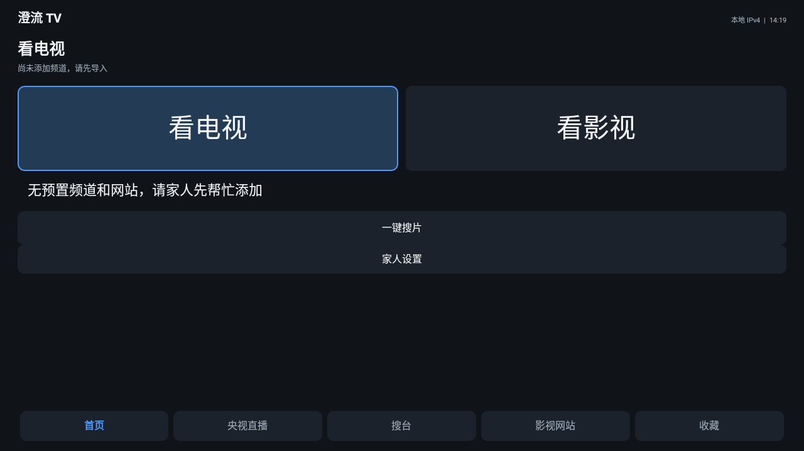
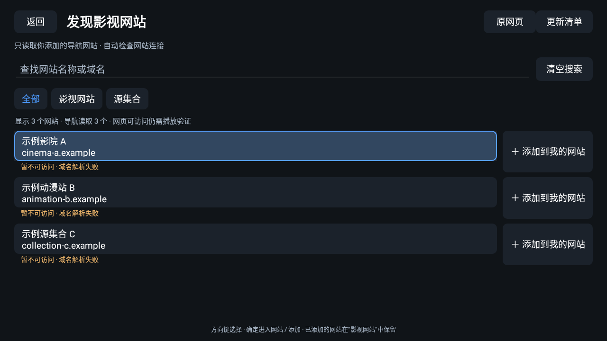
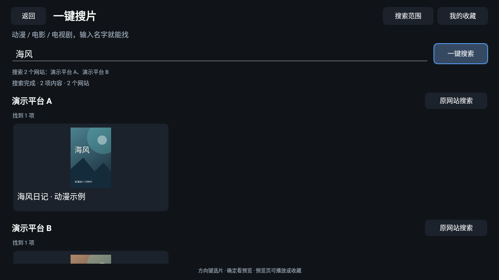
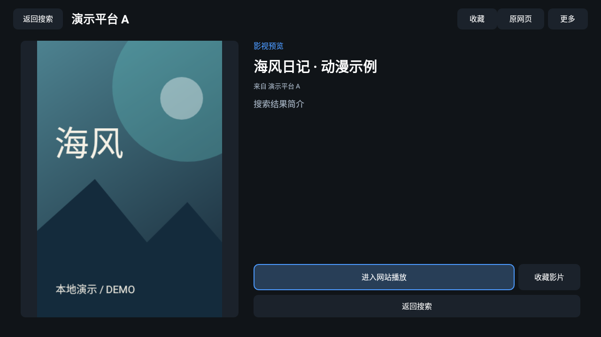
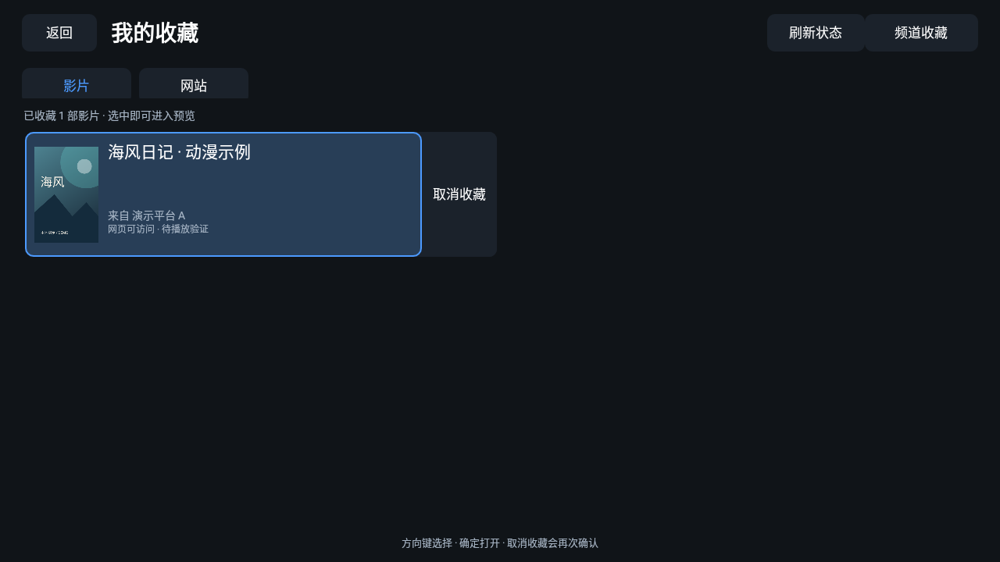
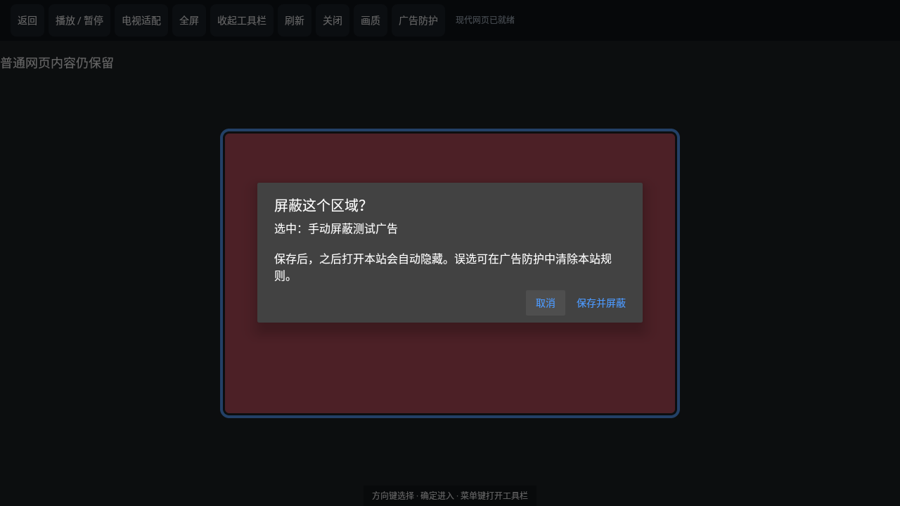

# 澄流 TV · 无源版

给电视和安卓机顶盒用的播放器。支持 IPv4 / IPv6 直播、自定义影视网站、多站一键搜片和收藏，使用遥控器就能操作。

**应用不预置频道、直播源、影视网站或订阅地址。首次打开为空，请添加自己有权使用的内容。**

[下载安装包](https://github.com/zrx986/ClearStreamTV/releases/tag/v0.1.13-nosource) · [详细使用说明](docs/使用说明.md) · [编译说明](docs/开发与编译.md)

## 能做什么

| 功能 | 简单说，就是 |
| --- | --- |
| 保存网站与源集合 | 把影视网站、导航网站或挂载源集合的网页保存下来，下次直接打开。 |
| 识别网站导航 | 将能识别的导航页面整理成网站列表，保留分类，用遥控器选择并添加网站。 |
| 从网页读取源 | 识别网页提供的 M3U、TXT、TVBox JSON 等订阅入口，选择后导入；保存订阅后可以再次更新。只读取节目清单，不执行 TVBox 插件。 |
| 多站一键搜片 | 片名只输一次，搜索自己选定的多个影视网站，分站展示动漫、电影和电视剧的结果。默认前 3 个可搜索网站，范围可修改，最多同时选 6 个。 |
| 影片预览 | 网站能提供时，显示封面、片名和简介，从预览页播放或收藏。 |
| 我的收藏 | 收藏频道、网站和影片，下次直接找，不必重新搜索。 |
| 同台多源 | 不同订阅里的同一频道合并展示，多个播放地址保存在备用线路中，仍可切换。 |
| 导入与管理 | 支持链接、M3U / TXT 文件、节目清单和订阅更新；支持分类、检测、清理失效源和清空全部 IPTV 源，删除前有确认。 |
| 电视遥控适配 | 大字、明确焦点，方向键选择、确定进入、返回上一级；为家人保留简易首页。 |
| 播放画面全屏 | 放大原播放器，标准版补充嵌套播放器适配；返回恢复网页，保留原画面比例。兼容版的全屏会实际放大识别到的画面。 |
| 查看真实画质 | 显示实际视频分辨率，可返回原站选择网站提供的更高画质；不会把低清视频标成 4K。 |
| 广告防护与点选屏蔽 | 基础广告请求拦截、常见广告位隐藏；遥控点选某个网页广告，确认保存后下次自动隐藏，支持清除本站规则。 |
| 双栈网络 | 支持 IPv4、IPv6 地址及双栈连接；源本身、家庭网络和设备都需要支持相应连接。 |
| 开放扩展 | 提供站点插件开发接口与示例，开发者可以增加布局、焦点和网页广告处理规则，修改后重新编译。 |

“网站页面能打开”不等于“每部影片都能播放”。搜索、导航和封面识别取决于网站结构；不支持原生整理时，可进入原网页使用遥控适配。网站自己的登录、会员、地区限制和广告仍由网站决定。

目前部分网站的识别、播放和复杂嵌套仍不兼容，欢迎 Fork 或提交改进。提供广告防护开关和手动点选规则；不提供任意第三方插件导入，也不能跳过所有视频贴片广告。见[贡献指南](CONTRIBUTING.md)和[站点适配与插件开发](docs/站点适配与插件开发.md)。

## 第一次怎么用

1. 在下方版本表中选一个安装包，复制到电视 / 盒子安装。
2. **看直播：**首页点「看电视」，选择自己准备的源文件或订阅链接，预览确认后导入，再选频道播放。
3. **看影视：**点「看影视 → 添加网站」，输入网址。支持的导航页可读取清单，再选需要的网站添加。
4. **一起搜片：**点「一键搜片 → 搜索范围」，选网站，输入片名，点「一键搜索」。支持的网站会显示原生结果卡片。
5. **下次继续：**在影片预览页或网站页面收藏，以后从首页底部「收藏」进入。

建议家人先完成导入和网站添加，长辈日常只需要选台、选片和打开收藏。

## 选哪个安装包

| 安装包 | 适用设备 |
| --- | --- |
| `ClearStreamTV-standard-0.1.13-nosource.apk` | **优先选这个。**Android 9 及以上、ARM32 / ARM64 电视和盒子；内置网页内核，文件较大。 |
| `ClearStreamTV-compatible-0.1.13-nosource.apk` | Android 6 及以上的旧设备；体积小，网页功能依赖系统 Android System WebView。 |

本版是测试预览版，使用开发签名。它使用独立安装标识，与之前的个人版分开安装，不会自动读取或删除个人版里的频道与收藏。非安卓系统、禁止安装 APK 的运营商盒子不一定能安装；最低系统版本声明也不等于所有型号都已实测。

## 示例图片

以下是安卓模拟器中的实际界面。演示网站、影片和海报由本地测试生成，**不随应用预置，也不是可用源推荐**。

### 简易首页

### 从网站集合添加入口

### 输入一次片名，多站搜索

### 预览后播放或收藏

### 收藏里直接找

### 嵌套网页播放器全屏

### 点选广告，确认后保存规则

## 常见问题

**安装后为什么没有频道？** 这是无源版，需要自己导入；项目不提供或推荐频道表。

**导入第二份频道表，为什么新增 0 条？** 完全相同的地址会去重；同名但地址不同的线路可以共存，在频道的备用线路中查看。

**网站能打开，为什么搜索不到或视频播不了？** 网站可能未提供可识别的搜索表单，或播放器有设备、登录、区域等要求。可尝试原网页、设置自定义搜索规则或更换自己添加的网站。

**检测显示可连接，为什么仍播放失败？** 网络连通只表示服务器有响应；应用会区分页面连通和实际播放记录，不把两者当成同一件事。

**能把节目变成 4K 吗？** 不能。可选清晰度取决于源或网站，画面比例调节不会增加原视频的清晰度。

**怎么屏蔽网页广告？** 网页里按菜单键，进入「广告防护 → 点选网页广告并隐藏」，方向键移动光标，确定选择，确认后保存。误选可以清除本站规则。网页结构变化后可能需要重新选择；跨域播放器内部的广告、Canvas 广告和视频中插入的广告不保证可处理。

## 项目与隐私

本项目自身不展示广告，不提供片库，也不上传用户的频道、网址或收藏。导入和收藏保存在本机；访问网站、订阅和使用网络检测时，会连接对应服务。详见[隐私说明](docs/隐私说明.md)。

项目自有代码采用 [MIT 许可证](LICENSE)，外部组件遵循各自许可证，见[第三方说明](THIRD_PARTY_NOTICES.md)。问题反馈请写明版本、设备型号、系统版本和出错步骤，避免贴账号、密码或含凭据的订阅链接。
